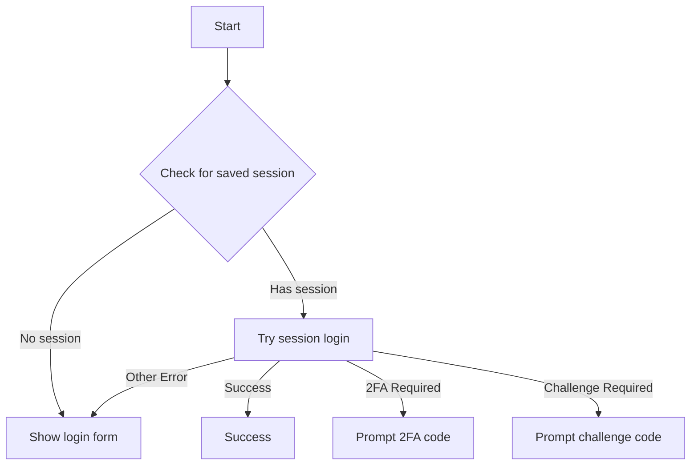
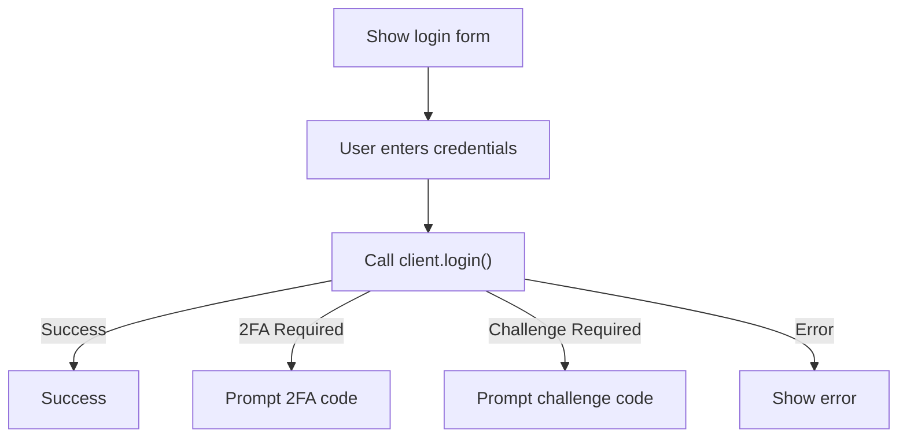
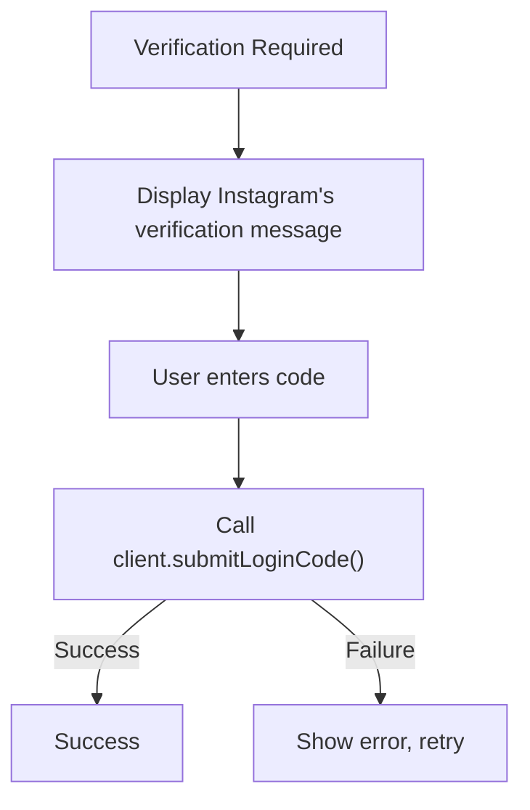
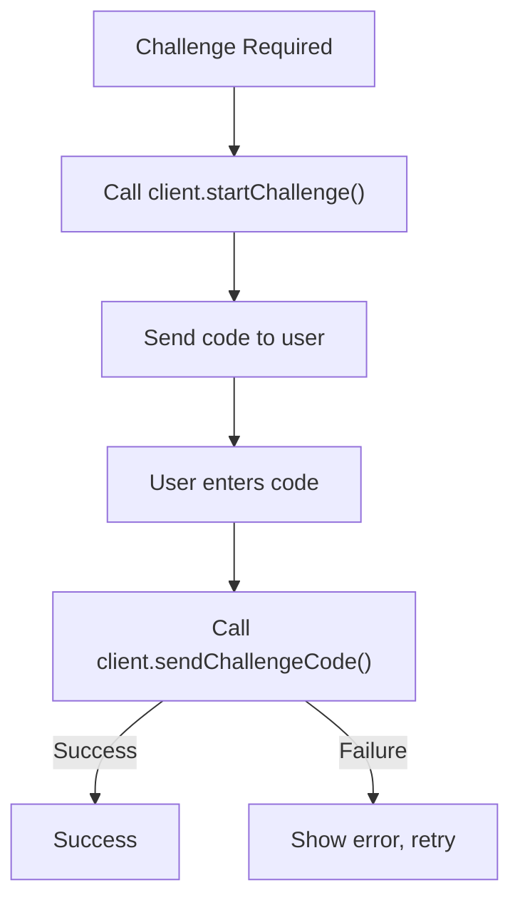

# Login Workflow Design

## Overview

The Instagram CLI implements a multi-stage login flow that handles various authentication scenarios including session-based login, username/password authentication, 2FA, and challenge-based verification. Login flow is a bit of back-and-forth between the CLI UI component (`login.tsx`) and the `InstagramClient` methods.

## Login Flow States

The login component (`login.tsx`) manages the following states:

- **`session`**: Attempting to login with saved session data
- **`form`**: Username/password login form
- **`2fa`**: Two-factor authentication code input
- **`challenge`**: Challenge verification code input
- **`success`**: Login completed successfully
- **`error`**: Login failed with error

## Workflow Sequence

### 1. Initial Session Login (Default Flow)

### 2. Username/Password Login (Manual Flow)

When `--username` flag is provided or session login fails:

### 3. Two-Factor Authentication

### 4. Challenge Verification

## Credential Login (CAA)

Instagram retired the legacy `POST /api/v1/accounts/login/` endpoint, which now answers every request with `needs_upgrade`. `client.login()` instead drives the Android app's current Bloks-based "CAA" flow, implemented in `source/utils/caa-login.ts` (ported from [instagrapi](https://github.com/subzeroid/instagrapi)'s `mixins/bloks.py`):

1. USDID registration (a locally generated P-256 device identity, sent as `X-Meta-Usdid`)
2. `caa.login.process_client_data_and_redirect` returns the account access context (`aac`)
3. `attestation/create_android_keystore/` returns the nonce for `X-IG-Attest-Params`
4. `caa.login.oauth.token.fetch.async` (credential preflight)
5. `caa.login.async.send_login_request` with the encrypted password

On success the session (authorization header and cookies) is embedded in the Bloks action payload. Otherwise the response routes to either the profile code challenge (`ap.two_step_verification.*`) or classic two-step verification (`two_step_verification.*`), and `login()` returns `verificationMessage`.

These requests go through `source/utils/caa-transport.ts`, a small HTTP/2 client whose TLS handshake resembles the app's (TLS 1.3 only, a single cipher suite, X25519/P-256). Instagram's edge answers `send_login_request` with an empty HTTP 429 for other TLS fingerprints. Logins also present a current Android device, since the sample devices bundled with `instagram-private-api` run Android versions the patched app version cannot be installed on.

## Key Components

### InstagramClient Methods

- **`login(username, password)`**: Primary credential-based login
- **`loginBySession()`**: Session restoration login
- **`submitLoginCode(code)`**: Completes a login that returned `verificationMessage` (2FA or security code)
- **`startChallenge()`**: Initiates challenge flow
- **`sendChallengeCode(code)`**: Submits challenge verification

### Error Handling

- **`verificationMessage` in `LoginResult`**: Triggers the 2FA / security code flow
- **IgCheckpointError**: Triggers challenge flow
- **Network/API errors**: Displayed to user with retry options

### Session Management

- Sessions stored in `~/.instagram-cli/users/{username}/session.ts.json`
- Current username tracked in config: `login.currentUsername`
- Automatic session saving after successful login

## Debug Logging

Added debug logs for non-standard login scenarios:

- 2FA requirement detection
- Challenge requirement detection
- Login failures with error details
- Session login failures

Logs are written to `~/.instagram-cli/logs/session-{timestamp}.log`

## Configuration

Login-related config keys:

- `login.currentUsername`: Last successfully logged-in user
- `login.defaultUsername`: Default user for future sessions

## Edge Cases

- **Session expired**: Falls back to credential login
- **2FA method detection**: TOTP vs SMS based on `totp_two_factor_on` / `sms_two_factor_on`; an 8-digit code is submitted as a backup code
- **Challenge retry**: Multiple attempts allowed
- **Client cleanup**: Automatic shutdown on component unmount
